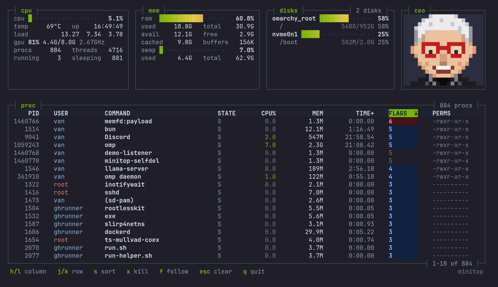

# minitop

Мінімалістичний монітор процесів для Linux. Читає `/proc`, малює таблицю в
терміналі власним ANSI-рендером (без ncurses) і за бажанням віддає процеси на
оцінку decision-моделі, а невпевнені випадки - ще й LLM. Один бінарник, без
демона, без обовʼязкового конфігу.



Режим 3 на реальній машині: у колонці FLAGS - бал моделі й колір вердикту, рядки вище порогу підсвічені.

## Навіщо

`top` показує цифри, але не відповідає на питання, чи процес вартий уваги.
minitop додає до звичайної таблиці шар судження: правило довіри відсіює те, що
доведено безпечне (пакет із core/extra, kernel thread, дочірній процес systemd),
решта отримує бал ризику 1-10, а в третьому режимі - ще й короткий вердикт із
поясненням. Оцінювання можна вимкнути повністю: тоді це просто швидкий
монітор, який споживає менше памʼяті, ніж `top`.

| режим | що працює | мережа | памʼять |
|---|---|---|---|
| 1 | лише таблиця | немає | ~5 МБ |
| 2 | decision-модель оцінює все, що не доведено безпечним | OpenRouter | ~19 МБ |
| 3 | модель як фільтр, далі LLM для невпевненої смуги | OpenRouter | ~19 МБ |

Режим 1 взагалі не вантажить HTTP-бібліотеку, тому й споживає менше за `top`.

## Вимоги

x86-64 Linux з glibc. Режиму 1 більше нічого не потрібно. Режими 2 і 3 під час
старту вантажать libcurl, тобто потребують встановленого `curl` (Arch) або
`libcurl4` (Debian); без нього таблиця працює, а колонка вердикту лишається
сірою. Для збірки з джерел - `gcc`, `make` і заголовки libcurl
(`curl` на Arch, `libcurl4-openssl-dev` на Debian).

## Встановлення і запуск

```sh
curl -L -o minitop https://github.com/ivanvan08/minitop/releases/download/v0.4.0/minitop-x86_64-linux && chmod +x minitop && ./minitop
```

`chmod +x` додає файлу біти виконання (`-rw-r--r--` -> `-rwxr-xr-x`). Без них
ядро відмовляє з `Permission denied`, бо для `execve` потрібен саме біт `x`,
а не вміст.

Той самий бінарник є в архіві - там права збережені, тож після розпакування він
уже виконуваний:

```sh
curl -L https://github.com/ivanvan08/minitop/releases/download/v0.4.0/minitop-v0.4.0-x86_64-linux.tar.gz | tar -xz && ./minitop
```

Класти бінарник можна будь-куди: це один файл, він нічого не встановлює.

## Перший запуск

При першому старті minitop створює конфіг у `$XDG_CONFIG_HOME/minitop/config`,
або `~/.config/minitop/config`, якщо змінна не задана, і друкує шлях:

```
minitop: created /home/you/.config/minitop/config
```

Файл створюється з правами 0600 у теці 0700 і ніколи не перезаписується -
правте вільно. Кожен ключ описаний усередині. Явний `--config PATH` нічого не
створює.

## Використання

```
minitop                    # вбудовані дефолти: режим 1
minitop --config FILE      # свій конфіг
minitop --help
```

Клавіші: `h`/`l` попередня і наступна колонка, `j`/`k` рядки, стрілки те саме,
`s` напрям сортування, `x` вбити процес (питає підтвердження, `y` підтверджує),
`f` вести вибраний процес, `q` вихід. З `navigation = false` у конфігу всі ці
клавіші інертні й працює лише `q`, тобто таблиця стає живим оглядом для
другого монітора.

## Ключ OpenRouter

Режими 2 і 3 звертаються до моделей через OpenRouter, тож потрібен ключ
OpenRouter. Він не вводиться в застосунку і не передається прапорцем - minitop
читає його з файлу:

1. Зареєструватись на <https://openrouter.ai> і створити ключ у розділі Keys
   (`sk-or-...`).
2. Покласти його у файл:

```sh
mkdir -p ~/.config/minitop
printf '%s\n' 'sk-or-...' > ~/.config/minitop/openrouter.key
chmod 600 ~/.config/minitop/openrouter.key
```

3. Перевірити, що гроші є на балансі: OpenRouter віддає `402`, і клітинка
   лишається сірою.

Шлях можна змінити в конфігу ключами `model.key_file` і `llm.key_file`, модель -
`model.name` (дефолт `baseten/mammoth-1`) і `llm.name` (дефолт
`deepseek/deepseek-v4.1-flash-1017`). Один прохід режиму 2 коштує близько
$0.005 на 30-40 запитів, один вердикт LLM - близько $0.0003. Без ключа працює
режим 1, і нічого не звертається до мережі.

## Збірка з джерел

Залежності, один раз:

```sh
sudo pacman -S --needed gcc make curl                      # Arch
sudo apt install build-essential libcurl4-openssl-dev      # Debian, Ubuntu
```

Далі:

```sh
git clone https://github.com/ivanvan08/minitop.git
cd minitop
make                # debug-збірка з символами: ./minitop
make release        # те, що в релізі: LTO, зайві секції прибрані, strip
```

Без заголовків libcurl збірка зупиняється з `*** libcurl development headers
not found (need curl/curl.h); install libcurl`.

`make test` проганяє набори тестів, `make test-asan` перезбирає їх з
AddressSanitizer і UndefinedBehaviorSanitizer, `make clean` прибирає всі
артефакти. Уся програма - 14 файлів `.c` і 13 заголовків у `src/` та `include/`.

## Документація

| файл | про що |
|---|---|
| [docs/project-overview.md](docs/project-overview.md) | що це, для кого, з чого складається |
| [docs/features.md](docs/features.md) | усі функції: шапка, таблиця, клавіші, режими |
| [docs/business-logic.md](docs/business-logic.md) | правила: кого оцінюємо, коли, що робимо з вердиктом |
| [docs/engineering-decisions.md](docs/engineering-decisions.md) | інженерні рішення з вимірами, зокрема проти `top` |
| [docs/model-evaluation.md](docs/model-evaluation.md) | вибір моделей, набір кейсів, результати, вартість |


## Хто що зробив

| Учасник | Внесок |
|---|---|
| Ivan Ulyanchenko ([ivanvan08](https://github.com/ivanvan08)) | ядро: читання `/proc` і `/sys`, обчислення CPU, прапорці, довіра до пакетів, конфіг, decision-модель і LLM-шар, промпти, звіти, тести, документація, збірка й релізи |
| Yuriy Bobrovnik ([Jorjio0](https://github.com/Jorjio0)) | рендерер TUI: рамки, шапка з панелями, таблиця, портрет; навігація `hjkl`, сортування, kill із підтвердженням, follow; ширина UTF-8 символів |
| Danylo Solovei ([gazerhest](https://github.com/gazerhest)) | модулі `cpu`, `flags`, `procs`, `sysinfo`; виправлення читання й обрізання UTF-8 у `sanitize_display_str` |

## Ліцензія

MIT, див. [LICENSE](LICENSE).
