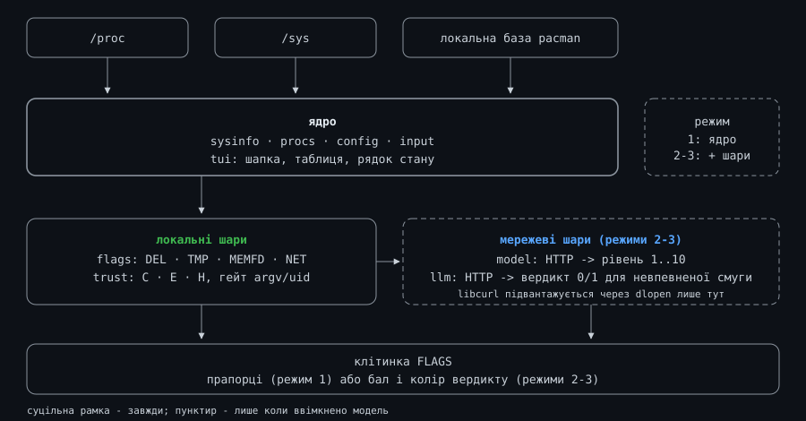

# minitop: огляд

minitop - невеликий монітор процесів для Linux. Він читає `/proc` і `/sys`,
малює один екран у терміналі й може додатково оцінювати процеси моделлю та
LLM. Це закінчений інструмент з одним бінарником і необов'язковим конфігом,
а не каркас для інших програм.

## Що це

- C11, без ncurses: кадр збирається з ANSI-послідовностей і Unicode
  box-drawing символів.
- 14 файлів `.c` і 13 `.h`, близько 7.9k рядків коду в `src` та `include`.
  Релізний бінарник - 150 520 байт.
- Один процес, без демона. Конфіг створюється при першому запуску, але
  програма працює і без нього.
- Дані про систему і процеси - з `/proc` і `/sys`; мережа потрібна лише
  двом необов'язковим шарам.

Три режими вмикаються конфігом: 1 - лише таблиця, 2 - decision-модель,
3 - модель як фільтр і LLM для смуги невпевненості. У режимі 1 немає
жодного мережевого виклику, і libcurl не завантажується.

## Для кого

- **Автор.** Дизайн робився під одну машину і демонстрацію, не під
  користувачів з підтримкою.
- **Демо у віртуальній машині.** Сценарій - запуск справжніх зразків
  малваре і показ трьох конфігурацій: без моделі, з decision-моделлю, з
  LLM.
- **Звичайний користувач, якому потрібен читабельний огляд системи.**
  Побачити, що зараз займає CPU, скільки пам'яті використано, чи не
  завершився котрийсь процес дивно.

Третій пункт - не обіцянка підтримки. Окремого режиму для нього немає;
це той самий екран, який бачить автор.

## Яку проблему вирішує

`top` показує набагато більше полів і керується мовою гарячих клавіш. Для
досвідченого адміністратора це нормально; для людини, яка просто хоче
зрозуміти стан машини, екран перевантажений, а потрібне число треба
шукати серед десятків інших.

minitop фіксує те, що видно з першого погляду:

- шапка: CPU, температура, uptime, load average, GPU, кількість процесів
  і потоків, пам'ять, swap, зайнятість дисків;
- таблиця: дев'ять колонок і одне сортування за вибраною колонкою;
- опційно: одна оцінка ризику на процес у колонці FLAGS.

Порівняння на машині з 810 процесами:

| | `top` | minitop |
|---|---|---|
| Що на екрані | значно більше полів і режимів | фіксована шапка і таблиця з дев'яти колонок |
| Керування | гарячі клавіші й команди | `h`/`l`, `j`/`k`, `s`, `x`, `f`, `q`; навігацію можна вимкнути |
| Оцінка процесу | немає | рівень 1..10 або вердикт LLM, якщо увімкнено |
| Пам'ять | 5.8 MB | 5.0 MB у режимі 1, 18.9 MB у режимах 2-3 |

## Чим не є

- Не професійний інструмент аналізу процесів. Немає окремих панелей по
  ядрах CPU, дерева процесів, історії і детального екрана процесу.
  `cmdline`, відкриті файли й змінні оточення в TUI не показуються.
- Немає системи гарячих клавіш, як у `top`: тільки навігація, сортування,
  `kill`, `follow` і вихід. `navigation = false` лишає тільки `q`.
- Немає підтримки `apt`. Метадані пакетів і правила довіри працюють з
  локальною базою pacman, тобто на Arch.
- Немає `nice`: процес можна вбити або взяти під follow, але не змінити
  його пріоритет.
- Не демон і не сервіс: поки програма не запущена, вона нічого не
  спостерігає і нікуди не пише.

## Архітектура

Ядро самодостатнє: воно читає `/proc` і `/sys`, рахує похідні величини й
малює кадр. Модель, правила довіри й LLM - знімні шари навколо цього ядра,
як обгортки навколо агентного харнеса PI: база має мало функцій, а кожен
додатковий шар вмикається конфігом.

Режим вибирає, які шари взагалі створюються: 1 - тільки ядро, 2 - ядро і
decision-модель, 3 - ядро, модель і LLM. Бібліотека libcurl підтягується
через `dlopen` лише коли стартує модель або LLM. Мережеві запити
обслуговуються через `curl_multi` і не блокують перемальовку кадру.

Довірені процеси (C/E/H) не віддаються моделі; це фільтр викликів, а не
твердження про безпеку. Правила, вибірка і пороги описані в
`business-logic.md`.

## Де читати далі

| Документ | Що там |
|---|---|
| [features.md](features.md) | шапка, таблиця, клавіші, режими, конфіг |
| [business-logic.md](business-logic.md) | кого оцінюємо, коли і що робимо з вердиктом |
| [engineering-decisions.md](engineering-decisions.md) | інженерні рішення з вимірами, зокрема порівняння з `top` |
| [model-evaluation.md](model-evaluation.md) | вибір моделей, набір кейсів, результати, вартість |
